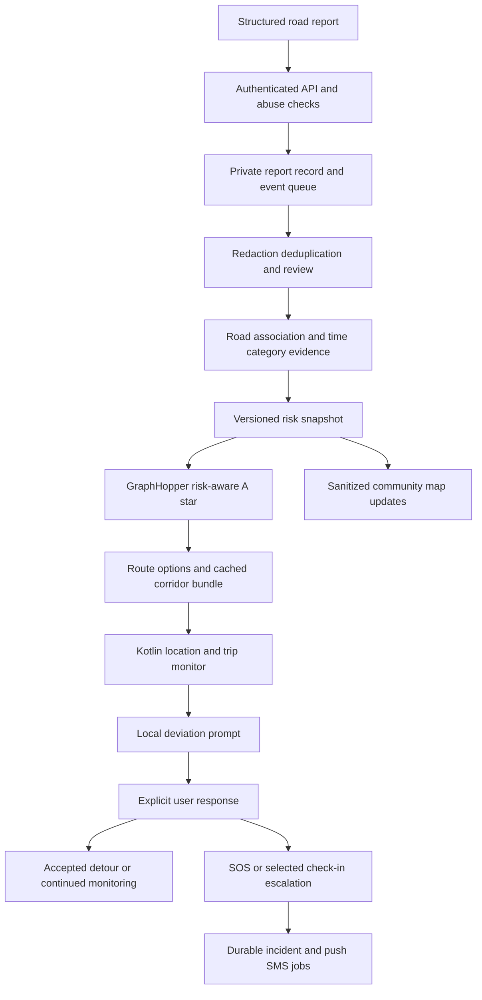

# Awaaz road intelligence and trip monitoring: production design

Prepared 12 October 2026. Scope confirmed by the user: adults in Bangladesh; first routing/community pilot covers Dhaka city; previous accounts and data are mock data, so legacy-user migration is not required. Flutter remains the app framework. This is a proposed production architecture and validation plan, not a claim that the system or model is already implemented or validated.

This document supersedes the earlier recommendations to preserve Firebase Authentication, keep Google Maps initially, and postpone all community reporting. The new design uses Supabase Auth, MapLibre/OpenStreetMap, moderated road reports, versioned risk-aware routing, and an on-device trip monitor. The general SOS, consent, operational, and launch requirements in the original update plan still apply.

Current implementation boundary: the first Flutter slice includes A* on a small fixture graph and a tested deviation state machine; the API includes validated reporting and a Supabase adapter. Real road graphs, scoring/ML, public moderation, the Kotlin foreground service and delivery workers remain planned. See `VERIFICATION.md` for evidence and limitations.

## 1. Feasibility and product contract

All four building blocks are feasible: collect structured local reports, estimate road conditions/risk, compute routes using A*, and alert a user about sustained route deviation while an explicitly started Android trip runs in the background. The difficult parts are trustworthy data, accurate road association, exposure/reporting bias, false alarms, and Android lifecycle behavior.

Awaaz should say "route with lower reported risk" or "safety-focused route based on available information." It cannot establish that a route is universally safest or that a driver intends harm. An account verified by phone/identity does not verify every statement it submits. No reports means unknown coverage until independent evidence supports a conclusion.

Core product outputs:

- A community road layer with status, category, age and corroboration, excluding personal accusations and victim whereabouts.
- Road intelligence separated into incident evidence, environmental conditions, traffic/access hazards, and information coverage.
- Fastest, balanced, and safety-focused route options with time/distance differences and evidence explanations.
- A user-armed trip monitor that detects meaningful deviation, asks the user what happened, and follows the user's selected escalation policy.
- Local SOS and check-in controls that remain independent of scoring/routing/model availability.

Dhaka-wide graph and app coverage do not imply uniform evidence coverage. Publish coverage/unknown indicators across the city. Collect balanced audits in multiple neighborhoods, transport settings and time periods rather than treating one well-reported neighborhood as representative.

## 2. Selected stack and boundaries

| Layer | Selected direction | Production purpose |
| --- | --- | --- |
| Mobile UI | Flutter; Riverpod; typed domain models; one router | Responsive map/session/report interfaces; UI does not own business transactions |
| Native mobile | Kotlin; Fused Location Provider; foreground location service; bounded local map matcher and deviation state machine | Monitoring and local notification survive a hidden Flutter screen within Android's supported conditions |
| Local state | Drift/SQLite cache/outbox with deliberate sensitive-data encryption; Android-backed key protection | Persist session state, route bundle, pending commands and cached resources |
| Map renderer | MapLibre Flutter with a licensed OSM-derived tile service | Custom risk layers, styles and permitted offline regions |
| Road graph/router | Self-hosted GraphHopper Java service; edge-based A*; custom request-scoped risk weighting | Control legal traversal, turns, graph versions, candidate routes and risk costs |
| Map data | Versioned OSM extract for Dhaka plus sufficient boundary buffer | Avoid disconnected graph boundaries; audit missing/incorrect access and turns |
| Geocoding | Managed OSM-compatible geocoder, selected by a Dhaka/Bangla benchmark | Address/landmark search; vendor must permit the chosen renderer and caching behavior |
| Identity | Supabase Auth: Google/email; phone verification for report publishing; admin TOTP | One identity authority; no Firebase Auth bridge or legacy account migration |
| Main database | Managed Postgres via Supabase, PostGIS, reviewed RLS and transactions | Reports, grants, incidents, sessions, moderation, spatial association and risk snapshots |
| Public API | TypeScript/Fastify modular application, request/response schemas and OpenAPI contracts | Report/route/session commands, authentication, access checks, idempotency and bounds |
| Background work | Transactional outbox and Postgres-native queue; short-lived workers and recovery sweeps | Delivery, moderation work, score refresh, expiry and durable session deadlines |
| Risk training | Python, scikit-learn baselines, LightGBM after evidence exists | Reproducible offline training; batch/materialized inference outside route latency path |
| Realtime | Authorized Supabase channels; versioned regional/route-corridor deltas | Update relevant road state without streaming all city activity to every phone |
| Private files | Supabase private Storage with scoped access and retention | Optional report evidence; never public by default |
| Push/SMS | FCM plus a tested Bangladesh SMS adapter | External contact alerts; local deviation notifications do not depend on FCM |
| Operations | Signed container images, CI, crash/performance monitoring, structured server metrics and OpenTelemetry where useful | Observe failures, queue age, graph/risk mismatch, latency and Android behavior |
| Admin/recipient web | Small TypeScript web application with scoped user/admin roles | Moderation, resource verification and expiring recipient access |

Keep the core API a modular application. Routing is a separate specialized service because it has an in-memory graph, Java extensions and different resource needs. Python scoring is a worker/batch job initially, not a synchronous public ML service. Introduce Redis only if measured contention/rate-limiting/cache needs justify it; it is not required as another durable queue.

GraphHopper supports OSM routing, A* variants, legal turns, alternatives and map matching. Stock APIs are not an arbitrary live per-edge crime-risk database: Awaaz must implement and benchmark the custom weighting extension. Valhalla is a valid alternative with runtime costing; choose it only if the prototype demonstrates better local functionality/operability for the team. Do not build road import, turn handling and graph search from scratch merely to own the A* function. [GraphHopper](https://github.com/graphhopper/graphhopper), [custom models](https://github.com/graphhopper/graphhopper/blob/master/docs/core/custom-models.md), [Valhalla costing](https://valhalla.github.io/valhalla/sif/dynamic-costing/).

Supabase supports native Google login and regional authentication SMS through a Send SMS Hook. Phone verification is account control, not proof of truthful incident reporting. Passkeys are currently documented as beta in the Flutter integration and should be optional until compatibility and recovery are validated. [Google auth](https://supabase.com/docs/guides/auth/social-login/auth-google), [SMS hook](https://supabase.com/docs/guides/auth/auth-hooks/send-sms-hook), [Flutter passkeys](https://supabase.com/docs/reference/dart/auth-signinwithpasskey).

Remove Firebase Auth, Firestore, Firebase Storage and Realtime Database from the new target architecture unless a concrete requirement appears. Retain Firebase Core/FCM and optional Crashlytics as supporting services. Update compatible stable dependency/toolchain versions after checking Android 16 and native packaging, not by choosing every newest package blindly.

## 3. System flow



Report processing can affect the risk overlay. A chosen route is computed against one immutable snapshot. A later report produces a new version and can cause a relevant advisory/recalculation, but never silently changes the baseline against which the user's driver is being monitored.

## 4. Report design, verification and moderation

### Structured categories

| Category | Acceptable report | Scoring/use |
| --- | --- | --- |
| Theft/snatching attempt | Experienced or directly witnessed event, approximate time and road | Time-decayed incident evidence, stronger weight after corroboration/review |
| Harassment/threat/following | Observable behavior and location; victim identity private | Separate behavioral hazard evidence; no appearance-based suspicion score |
| Environmental condition | Broken lighting, blocked footpath, isolated access, hazardous surface | Infrastructure/audit layer; relevance varies by walking/driving and time |
| Traffic/access hazard | Flooding, obstruction, dangerous crossing, temporary works | Mode-specific penalty; hard closure only with adequate authoritative/validated evidence |
| Subjective discomfort | "I felt uncomfortable here", structured reason and time | Perception layer with capped influence; not relabeled as confirmed crime |
| Official/partner advisory | Authenticated source and valid time window | Provenance-labelled information; distinguish restrictions from advice |

Replace "suspicious persons roaming" as a free-standing category with behavior-based descriptions, such as threats, following, an attempted theft, or blocking access. Names, faces, clothing, ethnicity, religion, homelessness and other appearance/status attributes must not become road-risk features or public person watchlists. This improves report quality and limits false accusations and abuse.

Accept a delayed report; the reporter may have needed to leave first. Store both event time and submission time. Let the user correct the road/side/direction and indicate uncertainty. Do not require photos, continuous tracking, NID uploads or proximity at submission as universal conditions for reporting.

### Minimum private report fields

`report_id`, authenticated `reporter_id`, category, first-hand/witness/hearsay/perception source, `occurred_at`, `submitted_at`, approximate geometry, claimed GPS accuracy if available, mode relevance, structured description, optional private attachment, moderation status, expiry/review date, corrections, and duplicate-cluster ID.

Exact geometry and evidence remain private to authorized operations. The community representation is a sanitized road section/area and coarse time/status; it omits author contact information, victim live position and identifiable accusations. Public map aggregation must use minimum-count/coarsening rules where a single report would expose a person or home. Infrastructure warnings may be more precise when their geometry does not disclose a person.

### Two verification dimensions

Account state: contact verified, abuse signals, optional partner role. Report state: received, provisional, corroborated, reviewed, disputed, withdrawn, expired. These must have different badges and different influence.

Raw statements are never published directly. High-trust, non-identifying infrastructure reports can be provisionally surfaced after automated validation; severe person-related allegations need stricter redaction/review. The system can show timely provisional information without pretending human review is instantaneous. Moderator decisions, corrections and expiry trigger reversible rescoring.

### Defense against manipulation

- Rate-limit accounts/devices/regions with proportionate limits; monitor clusters of coordinated posting and copied content.
- Collapse reports of the same event rather than count each submission as a new incident.
- Cap the influence of one contributor and correlated contributor groups; repetitions cannot manufacture independent corroboration.
- Use delayed/shadow publication for abuse-sensitive new accounts; permit private receipt even where public influence is limited.
- Reputation reflects review history with uncertainty and decay, not post volume or other users' popularity votes.
- An attested device, verified phone, nearby GPS or uploaded image is a signal, not conclusive proof of truth.
- Provide dispute, correction, withdrawal, appeal and moderator audit trail; contested reports have bounded influence.
- Never hard-block a road solely because several unverified accounts report it.

Moderation is a launch requirement for public road reports. A staffed process needs hours, queues, escalation, removal authority and Bangladesh-language competence. LLMs can assist text classification/redaction later; human-authorized rules control publication and consequential score updates.

## 5. Roads, report association and versioning

Use a directed, mode-aware graph with road geometry, speed assumptions, access, one-way behavior, turn restrictions, surfaces, bridges/tunnels and conditional restrictions where supported. A vehicle graph cannot route through a walking path simply because it has fewer reports. Bus journeys need expected service itineraries/GTFS where reliable, not arbitrary car-route optimization. CNG/motorcycle profiles require local restriction validation; don't claim every vehicle type at launch. [Turn restrictions](https://github.com/graphhopper/graphhopper/blob/master/docs/core/turn-restrictions.md), [OSM mode access](https://wiki.openstreetmap.org/wiki/OSM_tags_for_routing/Access_restrictions).

Import a versioned Bangladesh/Dhaka extract with a surrounding buffer determined by connectivity tests. Geofabrik publishes Bangladesh extracts, but their existence does not establish that every local road/one-way rule is correct. Track map defects and conduct field checks of bridges, service roads, alleys, complex intersections and selected origins/destinations. [Geofabrik Bangladesh](https://download.geofabrik.de/asia/bangladesh.html).

Graph edge IDs are local to an import. Maintain `(graph_version, edge_id, direction)` and provenance linking OSM way/node sequences and geographic segments. An OSM way ID alone is not one immutable road edge. Keep original report geometry; re-associate when an import splits/replaces edges. Retain old graph versions while active sessions depend on them, or perform an explicit tested bundle/version transition.

Use PostGIS candidate searches followed by direction/topology/geometry checks. Nearest line alone is insufficient around flyovers and parallel roads. When uncertain, allocate bounded association weights across plausible segments and reduce confidence; do not confidently mark an adjacent road. Reporters can correct association. [PostGIS spatial indexing](https://postgis.net/documentation/faq/spatial-indexes/).

## 6. Cold-start road intelligence

### Keep multiple dimensions

For each edge, mode and time bucket, store incident index, environmental/audit index, traffic/access state, uncertainty/coverage, contributing categories, last refresh, graph/risk/model version and provenance. A scalar route cost may combine them, but the UI should retain reasons and confidence.

Do not label a manually constructed number as a probability of assault/theft. Initially use low/moderate/elevated reported risk plus unknown coverage; avoid false precision such as "94% safe."

### Proposed transparent baseline

For a deduplicated event `i`, road edge `e`, category `c`, and query time `t`:

```text
w(i,e,t) = q_i * s_i * p(i,e) * exp(-ln(2) * age_i(t) / H_c)

evidence(e,c,t) = capped_sum_over_independent_event_clusters(w)

z(e,m,t) = baseline_prior(m,time,road_context)
           + audited_environment_penalty(e,m,time)
           + sum_c a(c,m) * log(1 + evidence(e,c,t))

r(e,m,t) = clamp(sigmoid(z), 0, 1)
u(e,m,t) = separately_estimated_uncertainty_or_missing_coverage
```

`q_i` is an editorial reliability weight, not a calibrated truth probability. `s_i` is policy severity, `p(i,e)` is uncertain spatial relevance, `H_c` is a category-specific half-life, and `a(c,m)` is mode relevance. Caps operate on contributors/correlated clusters as well as events. The logarithm limits domination by concentrated reporting; it does not solve reporting bias.

Decay starts from when the condition/event occurred, not when someone reposted it. Ongoing hazards require a last-seen/resolved workflow. Short-lived blockage, recent harassment and persistent broken lighting should not share one lifetime. Candidate pilot half-lives might be hours for transient events, days for incident context and review-based persistence for infrastructure; tune them with local evidence rather than adopt these as measured truths.

`u` must account for missing audits, association ambiguity, few independent observations, outdated reports and disputed evidence. No reports never sets `r=0,u=0`. Use a neutral uncertain prior and an explicit coverage indicator. Avoid penalizing poorly represented districts so strongly that the system never gathers data there.

Use consenting, aggregated traversal/time-at-risk statistics and structured audits to estimate coverage where justified. An incident count per road without exposure can make a busy road look worse solely because more people use/report it. Without defensible denominators, publish an evidence index, not a population incident rate. Research has demonstrated that differences in reporting rates can displace predicted crime hotspots; this is relevant to Awaaz's data design, not evidence that a Bangladesh model is validated. [Reporting-bias research](https://arxiv.org/abs/2102.00128).

## 7. Training a model later

Yes, a model can learn useful structure from this data, but model training must follow the definition of a measurable target and independent evaluation.

Suitable early targets: independently audited environmental hazard class; moderator-adjudicated road-condition severity; or future corroborated **reported** incident intensity conditional on observed coverage. These predict defined observations, not an individual's probability of victimization. Labels derived only from the baseline formula will train a model to imitate that formula, not independently learn actual safety.

### Dataset and features

Training unit: versioned road segment × relevant time bucket × mode, with a feature-availability cutoff. Candidate features include decayed category evidence, distinct event/contributor groups, report age/status, audit values, night/day, road access/surface, supported lighting observations, aggregate coverage, association uncertainty, and district-level missingness. Do not include personal identities, appearance, protected attributes or raw private trip histories.

Keep event-time and availability-time separate. A report submitted tomorrow cannot be a feature for yesterday's route prediction. Exclude reviews/corrections not available at the prediction cutoff. Duplicates from one event must stay in the same split.

Begin with a transparent hierarchical/GAM or count-model baseline, then compare LightGBM for tabular interactions. Use monotonic constraints only where the relationship is justified, such as more independently corroborated comparable hazards not mechanically lowering the modeled index. Retain confidence/coverage even if an ML score is introduced. Deep neural/GNN models are not the default response to a sparse city dataset. [LightGBM constraints](https://lightgbm.readthedocs.io/en/latest/Parameters.html).

Validation must combine forward-in-time holdouts with spatial blocks/buffer zones and grouped event clusters. Random row splitting lets neighboring segments or reports of the same event leak across training/testing. Generic TimeSeriesSplit or GroupKFold alone does not enforce all three; implement a combined splitter and inspect leakage. [Temporal validation](https://scikit-learn.org/stable/modules/generated/sklearn.model_selection.TimeSeriesSplit.html), [grouped validation](https://scikit-learn.org/stable/modules/generated/sklearn.model_selection.GroupKFold.html).

For a well-defined probabilistic target, assess calibration, log loss/Brier score and reliability diagrams as well as ranking/precision-recall. Those metrics do not turn a reported-event target into actual victimization probability. Examine missing coverage, uncertainty and errors by area, mode, time and device/reporting cohort. No universal report-count threshold establishes readiness; require adequate independent positives, seasonal/time coverage, local audits and confidence intervals. [Calibration](https://scikit-learn.org/stable/modules/calibration).

### Operational model lifecycle

Version dataset cutoffs, features, labels, policy, model artifact, evaluation and approvals. Batch-score affected edges; publish an immutable risk snapshot. Serve precomputed values from routing memory rather than calling Python/LLM on every explored edge. Keep approved baseline fallback and fast rollback. Shadow-test a candidate before it changes routes, and retain route-level explanations.

Observe reporting-rate changes, user-selection feedback, drift and calibration. Safer-route recommendations can change where users travel and submit reports, making the data policy-dependent. Independently audit a balanced road sample instead of only auditing places the model already flags. Do not intentionally send participants through known higher-risk routes to obtain labels.

## 8. Risk-aware A* and heuristic design

The following is Awaaz's proposed mathematical design. It must be implemented and checked against the pinned router version and a Dijkstra oracle before an optimality claim is made.

### Edge objective

For legal road edge `e`, mode `m`, snapshot `v`:

```text
c_v(e,m) = T(e,m) * [1 + lambda_m*r_v(e,m) + mu_m*u_v(e,m)]
           + turn_penalty(e_previous,e,m)

route_cost(P) = sum_e_in_P c_v(e,m)
```

`T` is traversal time in seconds. Risk `r` and uncertainty `u` are bounded indices. `lambda` and `mu` are nonnegative preference/policy coefficients, and turn penalties are nonnegative. These produce a generalized cost measured in seconds-equivalent; they do not alter the displayed ETA. Display ETA from actual traversal/turn-time assumptions separately. Authoritative closures or illegal access remove edges; ordinary uncertain reports impose bounded soft penalties.

Travel-time exposure is a proposed model, not a law about crime. It makes the objective independent of arbitrary edge splitting when attributes are uniform: two halves have the same total penalty as the unsplit segment. An unweighted sum/mean of edge scores fails this invariance and may reward graph artifacts. Include node/crossing hazards separately where appropriate.

### Search state and heuristic

For vehicle routing, state includes the current node and incoming directed edge because legal turns/costs depend on how the vehicle arrived. Use edge-based traversal. The familiar evaluation is `f(s)=g(s)+h(s)`.

A conservative first heuristic:

```text
h(s) = d_lower_bound(current_node, destination) / v_max(mode)
```

`d_lower_bound` must be a distance verified not to exceed any legal path length under the engine's actual geometry/rounding. `v_max` must bound every edge speed used in the request. Since edge cost is at least travel time, this is a lower bound on remaining total cost. Do not add guessed future road risk to the heuristic; that can overestimate and invalidate exact A*.

Derivation: for any legal remaining path `P`, its traversal cost is at least `sum(length_e/v_max)`, which is at least `d_lower_bound/v_max`; nonnegative risk, uncertainty and turns only increase it. With a suitable metric, `h(s) <= c(s,s') + h(s')` follows from triangle inequality and the edge-length/speed bound. Test this on graph rounding, virtual snapped edges and each profile. If the bound cannot be established, use `h=0` as the exact Dijkstra fallback.

After correctness and load tests, add an admissible directed-landmark/ALT bound from a lower-cost base graph. It stays a lower bound only while overlay changes add costs or remove edges; changed speed assumptions that decrease base costs require proof/recomputation. Avoid epsilon-weighted heuristics in a mode advertised as exact. [Router A* source](https://github.com/graphhopper/graphhopper/blob/master/core/src/main/java/com/graphhopper/routing/AStar.java), [landmark implementation guidance](https://github.com/graphhopper/graphhopper/blob/master/docs/core/landmarks.md).

### Live weights and route optimality

Freeze graph, base-time assumptions, mode, risk snapshot and coefficients for each request. Do not mutate overlay weights while A* searches. A new report affects a subsequent request. This first design is static-snapshot routing with relevant refreshes; truly time-dependent future risk/transit would require a separately validated algorithm/state model.

Keep an immutable in-memory risk array keyed by graph-version edge/direction, swapped atomically when a complete compatible snapshot is ready. The algorithm must not query Postgres for each expanded edge. Ordinary contraction hierarchies prepared with old weights cannot simply be assumed valid after arbitrary live risk changes. Start with flexible A* for risk-aware requests; retain acceleration only where its invariants are proven. [GraphHopper weighting/customization](https://github.com/graphhopper/graphhopper/blob/master/docs/core/custom-models.md).

Return fastest, balanced and safety-focused candidates. Distinct preferences yield distinct objective minima where available; alternatives can coincide. Deduplicate by geometry and explain additional time, coverage and evidence rather than offer three artificially different lines.

A user preference such as "at most 25% extra time" is a hard resource constraint, not the same as one weighted A* objective. V1 can generate several candidates and choose within the cap, clearly saying "best among these evaluated options." Global minimum risk within a time budget requires resource-constrained/multi-label search (state includes consumed time), or an explicitly approximate Pareto method. Do not claim an exact constrained optimum by filtering one A* result. Always return the legal fastest fallback where possible and explain if no better-evidenced option meets the cap.

### Illustrative arithmetic, not measured Dhaka data

With `lambda=1` and `mu=0.5`:

| Route | Time | Risk index | Uncertainty | Cost |
| --- | --- | --- | --- | --- |
| A | 12 min | 0.60 | 0.00 | 720 * 1.60 = 1152 |
| B | 14 min | 0.15 | 0.00 | 840 * 1.15 = 966 |
| C | 13 min | 0.05 | 0.90 | 780 * 1.50 = 1170 |

The objective prefers B. C's lack of information is visible instead of becoming a "safe shortcut." A real route integrates varying segment values and actual turns, with coefficients tuned through audits and user preference tests.

## 9. Map matching and deviation monitoring

GPS-to-route distance alone is too noisy near Dhaka's flyovers, parallel roads and complex intersections. Use a rolling sequence of location fixes, accuracy, speed, heading where meaningful, connectivity and elapsed time to estimate the traversed road. HMM/Viterbi map matching is an established approach to noisy location sequences; the classic research also documents degradation with sparse samples. [Newson and Krumm](https://www.microsoft.com/research/publication/hidden-markov-map-matching-noise-sparseness/), [GraphHopper map-matching module](https://github.com/graphhopper/graphhopper/blob/master/map-matching/README.md).

The Android trip monitor uses a bounded corridor graph/bundle downloaded before arming. It includes the chosen route, reasonable alternatives, direction/access, geometry, risk snapshot and local lookup structures. It is not an assumption that the entire GraphHopper server runs on the phone. Outside the bundle, detect probable departure conservatively and obtain a new bundle when connected; mark road match uncertain rather than invent a precise road offline.

Do not restrict the matcher to only the selected route, which would force an off-route vehicle to match onto it. Evaluate plausible nearby alternatives too. Keep uncertain candidates and topology constraints. Stationary heading, mock-location flags, coarse GPS, delayed batches and jumps need special handling.

### Local state machine

| State | Entry/behavior |
| --- | --- |
| `not_armed` | No continuous tracking; readiness failures visible |
| `tracking` | User started a trip; baseline route and permissible options/version stored |
| `position_uncertain` | GPS stale/coarse/ambiguous; indicate reduced monitoring quality, not suspicious behavior |
| `possible_deviation` | Evidence of leaving baseline corridor; collect enough reliable observations |
| `confirmed_deviation` | Sustained credible off-route movement; issue local check-in prompt |
| `detour_accepted` | User explicitly accepts the new route/baseline; log change, continue monitoring |
| `help_requested` | User triggers SOS or previously selected escalation policy is met |
| `completed/stopped` | End service and sharing; preserve only policy-authorized history |

A normal reroute must not silently overwrite the original permitted route and erase every deviation. Store `baseline_route_version` and `current_navigation_route_version` separately. Explicit user acceptance updates the baseline; advisory recalculation only updates suggestions until accepted.

### Deviation evidence

Combine route corridor departure, matched-edge confidence, sustained time/distance, travel direction, plausible alternate legality, changed ETA, risk information on the newly taken path and the user's response. Detours, congestion, pickups, roadworks and public-transport itineraries are valid explanations. Intent cannot be inferred from a route shape.

Illustrative thresholds to benchmark, not guarantees: at least three good fixes; approximately 10–20 seconds of sustained off-route motion; mode-appropriate progression such as 60–100 metres for a moving car and 20–40 metres walking; corridor width expanded with observed accuracy. Low confidence blocks strong deviation assertions. An ambiguous flyover fix should become uncertainty, not an emergency alert.

Define calibration for any probability used by the matcher; otherwise call it a confidence indicator, not "80% correct." Accuracy values are uncertainty signals, not hard error bounds. Monitor at intersections more frequently when feasible, with speed-adaptive sampling and hysteresis. Use cooldowns to avoid repeated prompts, but a new serious condition can override suppression.

User message: "Your trip has moved away from the selected route. Is this detour expected?" Actions: expected detour, keep watching, contact my people, SOS. Do not say "Your driver is a criminal." A credible new report ahead can produce a separate "recent report on this section" advisory without declaring the driver dangerous.

Escalation to trusted contacts needs explicit pre-trip opt-in and a clearly explained grace period. Nonresponse may mean the phone is in a pocket, asleep or notifications were muted; default deviation behavior should notify/check with the user first. Timed session escalation remains available under its own agreed policy. SOS is always immediately user-triggerable.

## 10. Android background and offline design

Arm monitoring while the app is visible through an explicit Start Trip action. Acquire the necessary permissions, persist the session/bundle and start a declared `location` foreground service with an ongoing notification. The Kotlin service receives location, updates the matcher/state machine and issues local notifications; it does not depend on Flutter's widget lifecycle or a cloud round trip.

Supported expectation: monitor while the screen is off and the app UI is in the background, subject to Android/device permissions and lifecycle. Not supported as a promise: invisible tracking after the user force-stops/stops the service, revokes permission, loses all usable location or turns off the phone. Android exposes a user stop control for foreground apps. [Service rules](https://developer.android.com/develop/background-work/services/fgs/service-types), [user stop behavior](https://developer.android.com/develop/background-work/services/fgs/handle-user-stopping).

Fused Location request intervals are hints; coarse permission can throttle/obfuscate results. Initial profiling targets might be 2–5 seconds while moving through vehicle junctions and longer intervals while stationary, with separate cloud-upload batching. Measure battery/heat/accuracy before freezing policy. Location batches use capture order/elapsed realtime; delayed older data cannot move the current snapshot backward. [Location request semantics](https://developers.google.com/android/reference/com/google/android/gms/location/LocationRequest).

Use WorkManager for deferred uploads/retries, not continuous trip monitoring or precise timers. The foreground service records recoverable local state, but automatic restart/resume must respect permission/start restrictions and user intent. Track service stop/heartbeat quality separately from user danger.

Local deviation alerts work without mobile data when usable GPS and the cached bundle remain available. Fresh community reports and online rerouting cannot be obtained offline; show last refresh. Full offline city routing is a separate feature and resource/licensing commitment. Cloud SOS delivery requires connectivity; SMS composer/dialer fallback has separate cellular requirements. Server-managed check-in deadlines can still run after a started session goes offline, under the stated policy.

Notification permission/readiness is checked before the app claims background alerts are armed. Haptics/sound must respect user/system settings; no guaranteed DND bypass or full-screen takeover. Test denied/coarse location, denied notifications, Doze, OEM battery policies, screen lock, process death, task removal, service stop, reboot, airplane mode and a long GPS outage as different conditions.

## 11. Data contracts and freshness

Add these to the core circles/incident/session schema:

| Record | Main fields/responsibility |
| --- | --- |
| `road_graph_versions`, `road_edges` | Import provenance, edge/direction geometry and legal mode access |
| `reports`, `report_events`, `report_attachments` | Private submission, availability/event times, review, redaction and ownership |
| `event_clusters`, `corroborations` | Deduplication, independent-source evidence and disputes |
| `report_edge_links` | Graph version, candidate edge, relevance/association quality |
| `road_audits`, `coverage_aggregates` | Audited conditions and privacy-preserving observation coverage |
| `risk_snapshots`, `edge_risk_values` | Immutable graph-compatible values, dimensions, confidence, provenance and policy/model version |
| `route_requests`, `route_options` | Mode, preference, snapshot/version, ETA and scoped retention |
| `trip_bundles`, `trip_events` | Baseline/navigation versions, local matcher inputs/state and explicit acceptance |
| `model_runs`, `evaluation_runs` | Dataset cutoff, artifact checksum, split definition, metrics and approval |
| `moderation_actions`, `public_report_views` | Controlled publication, coarse public geometry and auditable removal |

Sample route response contract:

```json
{
  "route_id": "opaque-id",
  "graph_version": "dhaka-import-id",
  "risk_version": "snapshot-id",
  "policy_version": "risk-policy-id",
  "mode": "car",
  "generated_at": "UTC timestamp",
  "risk_refreshed_at": "UTC timestamp",
  "expires_at": "UTC timestamp",
  "options": [
    {
      "kind": "balanced",
      "duration_seconds": 840,
      "distance_metres": 5200,
      "risk_band": "moderate",
      "coverage_band": "partial",
      "extra_time_seconds": 120,
      "reasons": ["fewer recent corroborated hazards", "some sections lack audits"],
      "geometry": "encoded polyline",
      "bundle_ref": "authorized bundle reference"
    }
  ]
}
```

Example values are illustrative. Never expose internal reporter identities or evidence attachments through a route response.

Mutation endpoints: submit/correct/withdraw/report-abuse, corroborate/dispute, moderator-review, start/accept-detour/complete-trip. Read endpoints: bounded regional road layer, route options, compatible bundle/deltas, own report status. All have versioned schemas, authenticated actor where required, limits and idempotency. Public reads return only sanitized aggregates.

Freshness pipeline: accept report -> persist/queue -> validate/deduplicate/review as needed -> re-score affected edges -> publish complete compatible snapshot -> invalidate relevant tiles/deltas -> advise affected trips. Recompute on expiry even if no new report arrives. Provisional automated updates may target under 30 seconds; human review may take much longer. Show these different states/timestamps instead of branding all information "verified real time."

Apply regional subscriptions and route-corridor filtering. Upon reconnect, fetch durable snapshot/version and replay/resync gaps; realtime is not the source of truth. Version signatures/checksums prevent graph/bundle mismatch. A revoked sharing grant immediately ends authorized recipient access. [Realtime authorization](https://supabase.com/docs/guides/realtime/authorization).

## 12. Smoothness, latency and deployment

### Mobile performance

- Keep expensive map matching, parsing and local risk work off the Flutter UI thread; Kotlin worker execution and isolates are used deliberately, with bounded memory.
- MapLibre renders vector layers; do not create a Flutter widget/marker for every city report. Query only the viewport and render simplified/coarsened overlays by zoom.
- Use vector-tile aggregation for public road layers where useful, backed by PostGIS spatial queries. Keep precise private reports off CDN caches. [PostGIS vector tiles](https://postgis.net/docs/ST_AsMVT.html).
- Load cached home/session data immediately; initialize nonessential services asynchronously with explicit readiness states.
- Debounce/cancel place search; preserve route/map view state; avoid rebuilding the entire screen on every GPS update.
- Keep short report flow and clear pending/synced status. Optimistic UI must not claim a report is published or SOS received before the corresponding server event.
- Profile release builds on representative low/mid-range Dhaka devices. Set a 60 Hz frame budget around 16.7 ms, and 120 Hz around 8.3 ms where supported, then measure jank/interaction latency rather than claim framework choice guarantees smoothness. [Flutter performance guidance](https://docs.flutter.dev/perf/best-practices).

### Proposed targets, not existing measurements

| Measure | Prototype/pilot target |
| --- | --- |
| Cached home interaction | Useful content shown immediately; cold-start p95 aim under 3 s on declared test devices |
| Routing engine | Warm Dhaka route compute p95 under 1 s at declared graph/load |
| End-to-end route options | p95 under 2.5 s on the declared test network; report network failures separately |
| Local deviation decision | p95 processing under 100 ms per fix; behavioral alert needs its sustained-evidence window |
| Map interaction | Under 1% missed frames in scripted pan/zoom/session exercises on declared devices |
| Provisional risk publication | Aim under 30 s after eligible acceptance; human-reviewed latency reported separately |
| Accuracy/false alarms | Gates derived from labelled replay/field data; initial aspiration under one nuisance alert per ten monitored trip-hours, with confidence intervals |
| Battery | Measure against unmonitored baseline by device/mode; select sampling only after results |

A responsiveness target that suppresses true deviations is not success. Measure recall, precision, latency, false alarms per trip-hour and inability-to-monitor states together. Rare-event detection cannot be validated by aggregate "accuracy" alone.

### Server performance and availability

Use resident graph and versioned risk arrays; batch affected-edge scoring; indexes on geometry/time/state; pooled DB connections; bounded queues; bounded route distance/visited-node/time limits; immutable snapshots; cache public layers and compatible graph metadata. Routing timeouts must return a clear failure/fallback, not an unfinished path labelled optimal. Fastify schemas help validate and serialize contracts, but do not replace business authorization. [Fastify schema guidance](https://fastify.dev/docs/latest/Reference/Validation-and-Serialization/).

Separate routing/ML load from SOS/session commands and delivery workers so an expensive route request cannot consume emergency capacity. Add route quotas/load shedding while preserving authenticated core help actions. Public-report abuse can never exhaust all notification job capacity; use priorities and separate bounded worker budgets.

Production: managed Postgres/Auth/Storage with appropriate recovery, supervised Linux containers for API/workers and routing, health checks, rolling graph swaps and independent uptime monitoring. Size compute from the real Dhaka graph and benchmark; don't assert that the current roughly 6 GB Windows laptop can run the entire public stack. Use the laptop for development, replay evaluation and small training experiments. Critical services must not depend on it being on.

Start with region/hosting selected after Bangladesh data review and measured latency. Multiple replicas do not create database disaster recovery by themselves. Preserve matched old graph versions during rollout, independently back up file objects, and exercise restores. Degraded mode retains cached trip monitoring; stale risk and unavailable rerouting are explicit. It does not invent new community intelligence during an outage.

OSM data does not mean free unlimited production tile/geocoder hosting. The public standard tile service prohibits offline prefetch, and public Nominatim has restrictions unsuitable for unrestricted app autocomplete. Use contracted or self-hosted services, attribution and reviewed ODbL/data separation. Keep private reports separate, but don't assume schema separation alone exempts derived databases/training data from licensing obligations. [Tile policy](https://operations.osmfoundation.org/policies/tiles/), [Nominatim policy](https://operations.osmfoundation.org/policies/nominatim/), [OSM attribution/licensing](https://osmfoundation.org/wiki/Attribution_Guidelines).

## 13. Privacy and responsible publication

Trip monitoring is session-scoped and visible; route-search origins/destinations and histories are private. Avoid uploading every high-frequency fix when local evaluation suffices. Give sharing, retention, optional research contribution and model-use purposes distinct controls. Default publicity is road evidence, never a live victim/contact map.

Reporter identities/evidence are restricted; public overlays use coarse geometry/time and sanitized descriptions. Minimum-count aggregation is context-dependent and cannot perfectly anonymize every rare incident; allow publication suppression where re-identification is likely. Do not let private report evidence escape through signed URLs, logs, AI prompts, model training exports or analytics.

No automatic police reports, person watchlists, identity-based risk prediction or broad public broadcasts of someone's distress. The user can contact established services, and reviewed partner workflows can be added later.

Bangladesh's current official privacy law includes instantaneous geolocation and crime-related allegations among sensitive data categories. Review consent, classification, transfers, retention, moderator access and evidence capture with qualified local counsel before real-user deployment. [Official 2026 act](https://bdlaws.minlaw.gov.bd/act-print-1692.html).

## 14. Delivery stages and acceptance

The expanded Dhaka road-intelligence scope replaces the earlier narrow-release estimate. A planning range is **24–36 weeks** with two to three engineers and ongoing design, QA, geospatial/data support and moderation. An ML upgrade depends on data maturity, not a fixed calendar date. This is an estimate with map/vendor/field-test contingencies, not a promise.

| Stage | Engineering output | Evidence required to progress |
| --- | --- | --- |
| 1. Foundations | Fresh Supabase Auth/schema; core SOS; MapLibre; legal Dhaka graph; report taxonomy/consent | Reproducible builds, ownership tests, map/access audit, working two-device incident |
| 2. Road intelligence baseline | Structured reports, redaction/review, deduplication, spatial association, expiry, confidence layer | Abuse simulations, ambiguous road association cases, moderator workflow, coverage displayed |
| 3. Routing prototype | Custom graph weighting, A*, conservative heuristic, versioned arrays, route explanation | Dijkstra agreement, legal turns/profile checks, unknown-area treatment, live snapshot correctness and load tests |
| 4. Trip monitor | Native service, cached corridor matcher, baseline/alternate versions, local prompts | Labelled replay plus field journeys, flyover/tunnel false-alarm tests, offline/lock/process lifecycle evidence |
| 5. Controlled Dhaka pilot | City-wide product access with clearly varying audit/report coverage | Consent-based exercises; measured false alarms, latency, battery, report manipulation and usability; operational ownership |
| 6. Public release | Bounded rollout, support/restore/runbooks, current Play disclosures | Critical gates passed; trained moderation and funded service capacity |
| 7. ML shadow/promotion | Versioned dataset, baselines and candidate model | Spatial/temporal/grouped holdouts, uncertainty/calibration analysis, no leakage, audited route behavior and rollback |

### Algorithm and data tests

- A* agrees with Dijkstra on sampled directed/turn-aware graphs across weights, modes and virtual start/end edges.
- `h(goal)=0`, nonnegative costs, lower-bound/consistency properties; edge splitting with uniform attributes preserves cost.
- Illegal turns/access cannot be selected; time budgets are respected under the advertised constrained/approximate method.
- A report cannot change a running request's snapshot. Edge/risk version mismatch is rejected, not silently ignored.
- Event copies, user clusters, disputes and expiry affect evidence as intended; zero reports remain uncertain.
- Replay of real consented traces includes parallel streets, flyovers, U-turns, tunnels, detours, stationary phones and GPS jumps.
- Accepted detours update the baseline explicitly; ordinary navigation reroutes don't erase monitoring history.
- No private reporter/media/route leaks through public tiles, exports, channels, cached URLs or model artifacts.
- Candidate ML evaluation excludes future-available labels/features and grouped events across folds.
- Offline local warnings remain possible within bundle/GPS limits; fresh risk/rerouting unavailability is labelled.

### Initial technical deliverable

Implement a thin vertical slice: one Dhaka area inside the city graph, structured reviewed report -> affected-edge snapshot -> fastest/balanced/safety-focused routes -> cached trip bundle -> screen-off deviation prompt -> explicit detour acceptance or SOS. Expand map/evidence validation across Dhaka before broad claims; do not wait for a trained model to validate the architecture.

## 15. Decision register

| Decision | Status |
| --- | --- |
| Old accounts/data are mock; no legacy-user migration | User-confirmed |
| Adults in Bangladesh; Dhaka city routing/community pilot | User-confirmed |
| Keep Flutter | Preserved from user scope |
| Supabase Auth + Postgres/PostGIS/Storage; FCM supporting service | Recommended replacement architecture |
| MapLibre + OSM-based controlled routing graph | Recommended for custom risk weights |
| GraphHopper custom A* weighting | Recommended, subject to prototype correctness/load gate |
| Transparent risk/coverage baseline before trained ML | Recommended release sequence |
| Local Android monitoring; server deadline/contact escalation | Recommended responsibility split |
| Phone/account verification separate from incident verification | Required product/data distinction |
| No appearance-based/person watchlist reports | Required quality/abuse boundary |
| Licensed geocoder/tile supplier and exact hosting | Procurement/legal/benchmark decision outstanding |
| Travel profiles, policy weights and deviation thresholds | Validate with Dhaka field/replay data |
| ML promotion date | Data/evidence-gated; not fixed by a report-count target |

All cited sources were checked during this design review on 12 October 2026. The equations, latency goals, thresholds and implementation choices are proposed Awaaz designs. They are not claims that the sources validate a trained Bangladesh road-safety model.
