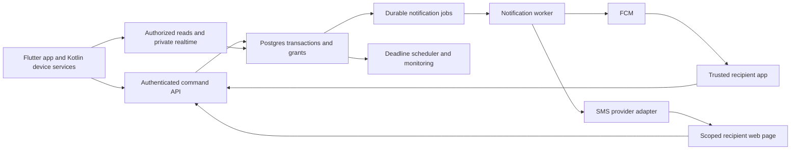

# Awaaz: research and production update plan

Research date: 12 October 2026, Asia/Dhaka. Repository baseline: `5e4c89f`.

User-confirmed direction: a public Android consumer product for adults in Bangladesh, especially students, commuters, friends, and family. Flutter stays. This document proposes changes; it does not change the application or deploy infrastructure.

Updated decisions from the subsequent design discussion: all previous data is mock data; no legacy-user migration is required. The first road-intelligence pilot covers Dhaka city. Supabase Auth replaces the earlier Firebase Auth retention recommendation, and MapLibre/OSM with custom GraphHopper routing replaces the earlier Google Maps-first recommendation. `AWAAZ_ROAD_SAFETY_DESIGN.md` is the detailed authority for the expanded community, scoring, routing and trip-monitor design.

Implementation has since started in `apps/mobile` and `apps/api`. This document remains the research/production plan; `DEVELOPMENT_PLAN.md` and `VERIFICATION.md` record what is actually built and checked. The root Flutter package is the preserved prototype, not the v2 entry point.

## 1. Recommended direction

Build Awaaz around three promises: start a time-limited safety session, reach people you trust when help is needed, and show clearly what happened to an alert. Replace the fixed parent/child relationship with mutually accepted trusted contacts and circles. An adult can share a journey with a friend today and assist a family member tomorrow.

The first release should offer trusted circles, reliable SOS, timed journeys/check-ins, Bangla and English, clear location freshness, a recipient web page for people without the app, and a verified local help directory. The expanded release also includes structured moderated road reports, a transparent road-risk/coverage baseline, risk-aware route options and native trip-deviation prompts. Trained scoring models are evidence-gated; geofences, richer private chat and evidence capture can follow.

Recommended technical direction: Flutter with clearer internal boundaries; a Kotlin layer for Android background location and local trip monitoring; Supabase Auth/Postgres/PostGIS/Storage and authorized Realtime; FCM; a TypeScript/Fastify modular API; durable notification jobs; Drift/SQLite; MapLibre/OSM and a GraphHopper routing service; offline Python risk-training/scoring workers; monitoring and automated release checks.

Start with one core backend application and one data authority, plus a specialized resident-graph routing service and short-lived scoring/delivery workers. A fixed-egress SMS adapter may be needed depending on the provider. There is no initial need for Kubernetes, Kafka, a vector database, or a fleet of unrelated microservices.

## 2. Research method and limits

This is a desk-research review of official product pages, help centers, government sources, and technical documentation, combined with the repository inspection. Competitor capabilities below are vendor-documented capabilities, not independent tests of their reliability. Geography, subscription, device, and operating-system restrictions matter. Product pages can change after this research date.

The "trends" are patterns inferred from this product sample and platform documentation, not statistical claims about market share. No competitor app was installed or field-tested. No deployed Awaaz database, account population, RLS policy, emergency contract, or production usage was available for inspection. The current JOY app's installability and operational response were not independently verified.

## 3. Comparable solutions and transferable ideas

| Solution | Vendor-documented focus | Ideas for Awaaz | Limitation to respect |
| --- | --- | --- | --- |
| Life360 | Family circles, location sharing, arrival/departure places, battery status, check-ins, temporary sharing, missed-arrival alerts, SOS | Circles, expiring sharing, member battery/freshness, arrivals, escalation to several contacts | Emergency dispatch is available only in specified countries/plans; the cited list does not include Bangladesh |
| Noonlight | Press/hold safety button, cancellation PIN, human verification and emergency dispatch | Clear activation/cancellation, distinguish feeling unsafe from immediate SOS, record response status | The cited service describes US coverage; an app integration is not a Bangladesh response agreement |
| Hollie Guard | Shake alerts, journeys, meeting timers, evidence capture, discreet mode, paid monitoring | Journey and meeting sessions, optional deterrent/silent modes, evidence controls | UK monitoring and evidence claims cannot be transferred to Bangladesh unchanged |
| bSafe | SOS, voice activation, guardian live audio/video | Accessible triggers and optional remote context | Background and pocket activation varies by platform; vendor voice claims do not establish universal Android behavior |
| WalkSafe | Journey sharing, SOS, partner-supported safe spaces, community reporting, organizational products | Verified help locations, campus/commute partnerships, expiring sessions | A "safe space" needs local verification and agreed assistance, not just a map marker |
| My Safetipin | Public-space audits, infrastructure-based scores, route options, support locations | Lighting/walkability audits; explain evidence behind route suggestions | The app explicitly says it is not an immediate-emergency service; local audit coverage is essential |
| Google Pixel Personal Safety | Safety checks, emergency sharing, emergency information and device-specific detection | Missed check-ins, status snapshots, accessibility, OS emergency education | OS integration and device/country restrictions differ from those available to third-party apps |
| Apple Check In | Arrival or timer sessions with information sharing if the session fails | A journey that ends automatically; minimum necessary information; clear escalation conditions | Useful interaction reference, not an Android API available to Awaaz |
| Bangladesh JOY | Government-described app supporting women and children facing violence | Connect users to existing Bangladesh services and official resources | Ministry page is evidence of the initiative; live app availability/response still needs confirmation |

Sources: [Life360 location features](https://www.life360.com/location-sharing), [Life360 SOS coverage](https://support.life360.com/hc/en-us/articles/23053474049687-SOS-Alerts), [Noonlight button behavior](https://help.noonlight.com/en/articles/2114600-how-does-the-button-work), [Noonlight response services](https://www.noonlight.com/solutions/personal-safety), [Hollie Guard](https://hollieguard.com/), [bSafe](https://www.getbsafe.com/), [WalkSafe](https://walksafe.io/), [Safetipin features](https://safetipin.com/my-safetipin-app/), [Safetipin limitations and audits](https://safetipin.com/my-safetipin-app-help/), [Pixel Personal Safety](https://support.google.com/pixelphone/answer/7055029?hl=en), [Apple Check In](https://support.apple.com/en-lamr/guide/personal-safety/ips56b5bc469/web), [Ministry JOY page](https://mowca.gov.bd/pages/static-pages/694032c835ce18e1c0562527).

### Patterns that should influence this update

1. **Safety sessions complement panic buttons.** Journeys and timed check-ins give people a reason to use the product before an emergency. Hypothesis for Awaaz: daily commute sessions will create more repeat value than a news feed. Validate this with interviews and pilot retention.
2. **Contacts need actionable context.** A current location with accuracy, capture time, battery status, and an explicit request is more useful than an unexplained red marker. A response acknowledgment is distinct from an alert being delivered.
3. **Professional response is an operating service.** Noonlight and Hollie Guard illustrate the human layer. Copying their screens does not create dispatch capacity. Awaaz should initially say it alerts trusted contacts and lets users call official services.
4. **Local partnerships make maps useful.** WalkSafe and Safetipin suggest a route toward campus security, assistance venues, NGOs, and audited infrastructure. Begin with a small verified directory in a pilot area.
5. **User control should be visible.** Make sharing temporary by default, identify who can see it, and give the sharer immediate revocation. Relationship labels must not grant surveillance privileges.
6. **Android lifecycle behavior is part of the product.** A solution tested only with the app visible cannot substantiate background safety claims.
7. **On-device AI is becoming practical for selected tasks, with uneven availability.** Google's ML Kit GenAI APIs have device, language, quota, and foreground restrictions. Treat AI as optional enrichment, never a dependency for SOS. [ML Kit capabilities and limitations](https://developers.google.com/ml-kit/genai).

## 4. Positioning and first release scope

Suggested positioning: "Awaaz helps you share a journey and reach your trusted people when you need help, with clear control over your location."

Example primary scenario: an adult student starts a 40-minute trip home, chooses two friends, and shares location for that trip only. Friends see when the trip was last updated. The student can check in, extend the expected arrival, or activate SOS. If the arrival deadline is missed, the server starts the agreed reminder/escalation policy. If the phone stops reporting, the screen says that contact was lost; it does not invent a cause.

Do not advertise guaranteed rescue, guaranteed delivery, universally safe routes, continuous tracking after force-stop, or monitoring by police without an actual agreement. Core SOS, consent controls, emergency dialing, and a small usable trusted circle should remain available without an emergency-time payment prompt.

First-release eligibility is adults only. Remove child-oriented marketing and onboarding from the launch path. Revisit a minors product separately with consent, safeguarding, recovery, and access rules designed for that audience.

## 5. Feature catalogue and priorities

Priority definitions: **Launch** = required for initial public release; **Next** = after core pilot evidence; **Later** = depends on data, operations, or a partner; **Explore** = research/prototype, no launch commitment. These are proposed Awaaz features, not claims that every competitor offers them.

### Trust, identity, and setup

| Feature | Priority | Concrete behavior and dependency |
| --- | --- | --- |
| Adult onboarding, Bangla/English | Launch | Explain what Awaaz does; choose language; enforce launch age policy without collecting identity documents by default |
| Email/Google login and recovery | Launch | Fresh Supabase Auth identity; account recovery, verified identifiers and understandable failures |
| Trusted-contact invite | Launch | Short-lived invitation code/link or QR; mutual acceptance; recipient opt-in for alerts |
| Multiple circles | Launch | Friends/family/commute groups; no compulsory parent or child role |
| Separate sharing permissions | Launch | Contact acceptance does not automatically enable persistent location or access to all incidents |
| Revoke, leave, block, report | Launch | Stop future access and notifications; invalidate grants and cached live views |
| Setup readiness and test alert | Launch | Show missing notification/location permissions, recipient setup and timestamp of last successful drill |
| Device/session management | Launch | Per-device tokens, remote session revocation, lost-phone recovery |
| Data export and deletion | Launch | In-app request plus website route; documented handling of records, media, jobs, and backups |
| Passkeys or additional login methods | Later | Prototype only after identity-provider support, recovery behavior and device coverage are verified |

### SOS and response

| Feature | Priority | Concrete behavior and dependency |
| --- | --- | --- |
| One understandable SOS action | Launch | Immediate-send option; optional brief cancellation countdown validated in usability tests; no yellow state with unclear commitment |
| Silent alert and optional siren | Launch | User selects behavior; silent means no intentional local siren, not invisible to Android system UI |
| Durable incident record | Launch | Stable ID, creation time, mode, current status, recipients, last location and audit trail |
| Explicit delivery states | Launch | Saved locally, received by server, provider accepted, delivered where measured, opened, acknowledged |
| Several trusted recipients | Launch | Server resolves authorized recipients; fan-out without a single-parent lookup |
| Push plus SMS policy | Launch | Push primary; SMS escalation through a tested provider; opt-in and bounded retries |
| Acknowledgment and response actions | Launch | "I saw this", "I am contacting you", "I can help"; only user-authorized resolution closes the incident |
| Cancellation and resolution updates | Launch | Stop future escalation and tell previous recipients; delayed jobs recheck current incident version |
| Unknown GPS fallback | Launch | Send the incident immediately with last-known/unknown location; obtain fresh GPS asynchronously |
| Emergency dialing | Launch | Open system dialer with verified local number; no automatic dispatch promise |
| Non-app recipient page | Launch | Small web page with scoped expiring access; explicit acknowledgment POST, never acknowledge on page load |
| Home widget/Quick Settings tile | Next | Native trigger with carefully tested lock-state and permission behavior |
| Push-to-talk or voice shortcut | Explore | User-enabled session, noisy Bangla/English tests and battery measurements; conventional trigger remains primary |
| Shake activation | Explore | Session-scoped, debounced, user-configurable; measure accidental triggers first |
| Duress cancellation code | Explore | Requires specialist usability and threat-model review; coercion and discoverability complicate it |
| BLE button or Wear OS companion | Later | Pairing, permissions, disconnect warnings and device compatibility; no universal accessory support |
| Trained response partner | Later | Agreement, staffing, coverage, escalation protocol, exercise results and clearly published hours |

### Journeys and location

| Feature | Priority | Concrete behavior and dependency |
| --- | --- | --- |
| Timed journey | Launch | Destination or descriptive trip, recipients, ETA/deadline, extension, completion and server-side timeout |
| Meeting/check-in timer | Launch | Same session engine without a route; reminder then agreed escalation |
| Automatic end to sharing | Launch | Session expiry and completion terminate location grants and device tracking |
| Location freshness and accuracy | Launch | Capture time, server receipt time, accuracy radius, stale/unknown label and optional battery value |
| Low-data offline behavior | Launch | Cached contacts/directory, local event queue, last-known location and SMS/dialer actions |
| Adaptive tracking | Launch | Higher frequency during active SOS, lower during ordinary sessions; no tracking when sharing is off |
| Temporary browser sharing | Launch | Recipient-scoped, expiring link; revocable; distinguish bearer access from authenticated access |
| Arrival/departure geofences | Next | Explicit opt-in, hysteresis, delay warning and battery/permission tests |
| Route deviation prompt | Launch | Native trip monitor, prompt before selected escalation, explicit detour acceptance; account for GPS error and legitimate route changes |
| Low-battery/lost-contact notice | Next | Mark observation time; distinguish no update from verified disconnection |
| Short optional location history | Next | Opt-in retention; no unlimited default trail; access grant and deletion controls |
| Offline map regions | Later | Licensed tile downloads, storage budget and provider terms; cached GPS is not an offline street map |
| Route options with safety evidence | Launch | Transparent risk/coverage baseline, local audits, provenance and confidence; trained models promoted after evaluation |
| Ride details | Next | Optional vehicle/ride label and expected destination; manual input before any transport integration |

### Communication, evidence, and local support

| Feature | Priority | Concrete behavior and dependency |
| --- | --- | --- |
| Minimal incident messages | Launch | Structured status and optional short text to the selected recipients |
| Existing private chat hardened | Next | Pagination, offline queue, block/report, private attachments and delivery receipts |
| Configurable fake call | Next | Caller label, delay, sound controls and fast cancellation; no real phone call claim |
| Verified local help directory | Launch | Offline cache; official sources, last checked date, service scope, call button and correction route |
| Bangla safety resources | Launch | Human-reviewed short articles relevant to local commuting and harassment |
| Partner safe venues/campus security | Later | Venue onboarding and periodic re-verification; explain hours and actual assistance |
| Incident timeline/export | Next | User-owned account of alert, responses and location samples; omit other users' unnecessary details |
| Opt-in audio/photo/video | Later | Explicit recording action, visible permissions, encrypted private storage, retention and local review |
| Live audio/video | Later | Only after connectivity, battery, recording rules and responder capacity are established |
| Community incident reporting | Launch | Structured moderated road reports, sanitized/coarse public location, provisional/reviewed status, expiry and abuse/appeal workflow |
| Infrastructure audit | Later | Lighting, walkability and support access; do not publish private homes or individual journeys |
| Broad breaking-news feed | Deprioritize | Replace with curated relevant resources or official alerts; news is not actionable local safety intelligence |
| Public nearby-volunteer broadcast | Defer | Unknown responders can expose a person in distress; requires verified partners and response protocols |
| Fall/crash/scream detection | Explore | Sensor dataset, false-positive/negative evaluation and staged trials; a heuristic is not a validated detector |

### Operations and optional AI

| Feature | Priority | Concrete behavior and dependency |
| --- | --- | --- |
| Delivery health dashboard | Launch | Queue age, failed jobs, provider errors and synthetic drills; redact identity and coordinates by default |
| Support and abuse console | Launch | Restricted access, audit trail, reports and user recovery; authorized access to incident details only when necessary |
| Feature flags and kill switches | Launch | Disable a failing optional feature without removing emergency dialing or core help actions |
| Bangla/English report transcription | Later | User-approved input, consent before cloud transfer, correction screen and language benchmarks |
| Incident summary | Later | Draft from recorded facts, source timestamps, human review and original record preservation |
| Search over curated resources | Later | Retrieve verified content with sources and update dates; no autonomous emergency decisions |
| Moderation assistance | Later | Classify likely abuse to assist human reviewers; appeals, local-language evaluation and auditability |
| AI emergency triage/dispatch | Do not ship initially | An LLM must not decide whether to transmit SOS or suppress an alert |
| Facial recognition / predictive crime | Do not adopt | Poor fit to the product, intrusive collection, unproven local benefit and potential discriminatory outcomes |

## 6. Stack decisions

| Layer | Current state | Recommendation | Why / alternative |
| --- | --- | --- | --- |
| UI framework | Flutter | Keep Flutter | Preserve work and skills; upgrade compatible stable tooling as needed, not the framework |
| App organization | Business logic inside screens | Feature modules + repositories + use cases; Riverpod for lifecycle/state; typed models and one router | Keep UI independent from auth/database/network APIs; Bloc is reasonable if the team already knows it |
| Authentication | Firebase Auth | Replace with Supabase Auth | User confirmed old data is mock; one identity authority simplifies the fresh relational backend |
| Domain data | Supabase + Firestore | Supabase Postgres as the eventual domain source of truth | Relationships, incidents, deadlines and votes benefit from relational constraints and transactions |
| Spatial queries | Latitude/longitude fields | PostGIS for indexed geography where queries justify it | Useful for directory proximity, audit areas and geofences; do not introduce GIS complexity just to draw a marker |
| APIs/business commands | Direct screen writes + one function | TypeScript/Fastify modular API with validated contracts and database transactions | Prefer small command handlers over screen-level multi-step writes; route/model work stays outside the core latency path |
| Background jobs | One-shot FCM request | Transactional outbox + Supabase Queues + deadline scheduler | Retry safely, persist work, observe failure and recover from worker restarts |
| Push | FCM | Keep FCM | Use high-priority visible alerts appropriately; clean invalid per-device tokens |
| SMS | None | Local A2P provider candidate, behind an adapter; international option only after local tests | Sender registration, carrier reach, delivery reports, Bangla segmentation and cost matter more than SDK fashion |
| Realtime | Postgres change subscriptions | Authorized private channels with durable database resync | Realtime transports events; it is not the source of incident state |
| Files | Firebase profile photos + public Supabase chat images | Fresh private media in Supabase Storage | Private buckets, scoped access and unified deletion; no mock file migration required |
| Device persistence | SharedPreferences favorites | Drift/SQLite for sessions, contacts, outbox and cache; preferences for preferences only | Transactional persistence and typed migrations; add deliberate encryption/key management for sensitive data |
| Maps | Google Maps and legacy web endpoints | MapLibre + licensed OSM-derived tiles/geocoder; GraphHopper risk-aware routes | Control graph weights and road overlays; verify Dhaka map/access quality and licensing |
| Android execution | Unwired power-button service | Kotlin foreground location service, Fused Location Provider, WorkManager for deferred sync, tile/widget bridge | Native lifecycle handling while Flutter remains the UI |
| Monitoring | Print/debug logs | Crash/error monitoring plus server delivery metrics; Crashlytics initially or Sentry after SDK/privacy evaluation | Never send exact location, contact lists, media URLs or message bodies to default analytics |
| Integrity | None | App Check/Play Integrity as additional abuse signals | Identity and access rules remain mandatory; staged enforcement avoids denying help on attestation outages |
| Environments | Embedded project settings | Separate dev/staging/prod, managed secrets, restricted client keys, reproducible SQL/config | Client publishable keys are expected to be public; privileged secrets belong on servers |
| Delivery | Minimal tests, debug release signing | GitHub Actions checks, signed AAB, Play testing tracks, reviewed migrations and rollback | Build repeatably and demonstrate core behavior under failures |

Technical support: [Flutter architecture](https://docs.flutter.dev/app-architecture), [offline-first design](https://docs.flutter.dev/app-architecture/design-patterns/offline-first), [Drift](https://drift.simonbinder.eu/), [Riverpod provider lifecycles](https://docs-v2.riverpod.dev/docs/concepts/provider_lifecycles), [Supabase Firebase integration](https://supabase.com/docs/guides/auth/third-party/firebase-auth), [PostGIS](https://supabase.com/docs/guides/database/extensions/postgis), [Supabase Queues](https://supabase.com/docs/guides/queues), [Cron](https://supabase.com/docs/guides/cron), [Realtime authorization](https://supabase.com/docs/guides/realtime/authorization), [Flutter App Check](https://firebase.google.com/docs/app-check/flutter/default-providers).

### Auth decision: a fresh Supabase identity authority

The user confirmed that all previous accounts/data are mock data. Choose Supabase Auth with Google/email login, phone verification for public report submission, account recovery and admin TOTP. A contact-verified account does not make every report verified. Use the Supabase user UUID as the stable profile owner and derive actors from verified tokens; do not trust request-body user IDs. [Google login](https://supabase.com/docs/guides/auth/social-login/auth-google), [regional SMS hook](https://supabase.com/docs/guides/auth/auth-hooks/send-sms-hook).

The earlier Firebase JWT bridge remains a technically supported alternative, but is unnecessary for this fresh build. Remove Firebase Authentication and the duplicate Firebase domain databases/storage from the target design. Keep Firebase Core/FCM and optional crash diagnostics. RLS, Storage, Realtime and privileged command authorization still need staging tests. [Function authentication guidance](https://supabase.com/docs/guides/functions/auth).

### Map decision

The new requirement needs custom road weights and a graph we can control. Use MapLibre for rendering, licensed OSM-derived tiles/geocoding, and GraphHopper with a custom risk-weighting extension. Keep renderer/search/routing interfaces separate. MapLibre does not itself provide free production tiles, search, routing or complete Bangladesh data. Verify licensing, attribution, local results, packaging and offline rights. [MapLibre Flutter](https://maplibre.org/flutter-maplibre-gl/), [GraphHopper](https://github.com/graphhopper/graphhopper).

The existing Google Places/Directions calls are legacy implementation context, not the selected new route-risk engine. Do not extract a new road graph from proprietary map results or mix data/renderers without checking the relevant terms. The detailed A* objective, heuristic, graph versions, confidence and trip-monitor contracts are in `AWAAZ_ROAD_SAFETY_DESIGN.md`.

## 7. Proposed system and data model

### Main records

| Record | Minimum responsibility |
| --- | --- |
| `profiles`, `identities` | Stable domain identity, language and verified auth subject mapping |
| `devices` | Profile owner, token, platform, app version, last activity and revocation |
| `circles`, `circle_memberships` | Accepted group membership and administrative roles |
| `invitations`, `trusted_contacts` | Expiring invite, acceptance, recipient phone verification/opt-in and contact relationship |
| `sharing_grants` | Who can see whose location, purpose, precision, incident/session scope and expiry |
| `safety_sessions` | Journey/meeting/check-in, deadline, state/version and recipient policy |
| `incidents`, `incident_recipients` | Alert and authorized response participants |
| `incident_events` | Server-sequenced event log for cancellation, acknowledgment and resolution |
| `current_locations`, `location_samples` | Last-known snapshot and optional bounded session history |
| `notification_jobs`, `delivery_attempts` | Recipient/channel, due time, deduplication ID, attempt result and retry policy |
| `acknowledgments` | Which participant took which explicit action and when |
| `share_tokens` | Hashed scoped bearer token, expiry, use restrictions and revocation |
| `help_resources` | Official/partner provenance, service scope, verification date and language |
| `messages`, `attachments` | Private participants and owned media, if richer chat is enabled |
| `reports`, `moderation_actions`, `audit_events` | Abuse handling and privileged-action accountability |

Normalize the existing `child_emails` array into relationships. Email is a verified contact/invite attribute, not a permanent ownership identifier. Never automatically grant location access simply because someone has typed another person's email.

Store timestamps in UTC; localize display in Asia/Dhaka. Location has `captured_at`, `received_at`, `accuracy_m`, monotonic session sequence and source. Old samples must not overwrite newer snapshots. Expired/revoked viewers must not keep receiving updates through an already-open channel.

### API contracts to implement

`createInvite`, `acceptInvite`, `revokeGrant`, `startSession`, `extendSession`, `completeSession`, `createIncident`, `acknowledgeIncident`, `cancelIncident`, `resolveIncident`, `registerDevice`, `requestExport`, and `requestDeletion`.

Each mutating command needs a versioned request schema, verified actor, scoped authorization, an idempotency key, input limits, structured failures and event logging. Resolve recipients on the server; never trust a client-provided `parentId` or unrestricted target phone number. A retry of the same command must return the same logical result.

### Proposed app navigation

Use a small primary navigation: Home, Circles, Help, and Profile. Keep an active journey or incident reachable throughout the app. A public news/forum feed should not occupy the emergency home screen.

| Screen | Primary job |
| --- | --- |
| Onboarding/login | Explain adult eligibility, service scope and account recovery |
| Home | Start SOS, a journey or a check-in; show readiness and active session |
| Circle/contact setup | Invite, accept, choose sharing scope and review recipients |
| Journey setup | Select destination/timer, deadline and recipients |
| Active session | Show sharing scope, freshness, extension, completion and immediate SOS |
| Active incident | Show server receipt and each recipient's measured response; cancel/resolve |
| Recipient incident | View authorized location/context and explicitly acknowledge/assist |
| Help | Verified local contacts/resources with offline access |
| Profile/privacy | Devices, permissions, grants, language, retention, export and deletion |
| Support | Report abuse, correct resources and recover access |

Design for large text, screen readers, one-handed use and non-color status cues. A high-stress user should not need to navigate through unrelated content to act.

## 8. SOS and session reliability design

Keep incident lifecycle, channel delivery, and human response as separate dimensions:

- Incident lifecycle: `active`, `cancelled`, `resolved`; local pending submission is a device state, not server confirmation.
- Recipient/channel lifecycle: `queued`, `attempting`, `provider_accepted`, `delivered_if_measured`, `failed`, `expired`.
- Human response: not opened, opened where observed, acknowledged, assisting. Acknowledging never means the person is safe.

### End-to-end incident processing

1. Device saves a new incident command locally with a unique ID. UI immediately distinguishes local persistence from server receipt.
2. Start permitted location acquisition, but submit without waiting for a fresh GPS fix. Include a dated last-known position or an explicit unknown value.
3. Server authenticates the actor, resolves accepted recipients and valid grants, and atomically records the incident plus outbox jobs.
4. Return the incident ID and server receipt time. Once accepted, the server continues escalation even if the originating app is killed.
5. Worker consumes due jobs, sends per-device FCM alerts and records the provider outcome. Persist before returning work to the queue.
6. Offer an explicit recipient acknowledgment. Where it is absent, execute the configured SMS/escalation policy, subject to cancellation/resolution and caps.
7. Device uploads fresh locations independently of push success. Recipient screen re-fetches durable state after notification/reconnection.
8. Cancellation/resolution is an authenticated command that updates state, stops future jobs and issues an appropriate update to already-notified recipients.
9. Worker rechecks incident state/version before every attempt. Provider callbacks must be authenticated and deduplicated. Queued old alerts must not revive a cancelled incident.

Suggested starting policy for pilot testing, not a measured promise: send initial push immediately; if no explicit response by 20–30 seconds, send one SMS to selected contacts; after 60–90 seconds offer/escalate to the next preselected contacts; stop automatic repeats after a defined budget/time window and show lack of acknowledgment. For selected high-urgency modes, allow push and SMS simultaneously. Contact consent and user-selected policy determine this behavior.

Use bounded exponential retries, jitter, a dead-letter queue, worker leases and deduplication constraints. If a provider accepted a message but the worker crashed before storing that fact, duplicate delivery remains possible; mitigate with provider idempotency where supported and stable incident/channel IDs. A queue's visibility-window guarantees do not make external SMS/push effects globally exactly-once. [Queue semantics](https://supabase.com/docs/guides/queues/pgmq).

FCM returning a message ID means acceptance for delivery, not actual delivery or human response. Choose urgent-message TTLs intentionally; do not let an old emergency notification misleadingly appear active weeks later. Include an incident version and revalidate on open. [FCM message lifecycle](https://firebase.google.com/docs/cloud-messaging/customize-messages/setting-message-lifespan).

Use high-priority FCM for genuine visible urgent notifications; Android can deprioritize misuse. Match the app's actual channel ID, test notification denial/Doze and avoid network-dependent rendering before displaying the alert. [FCM Android priority](https://firebase.google.com/docs/cloud-messaging/android-message-priority).

### Server-managed deadlines

Journey and meeting deadlines are persisted server-side. A scheduler enqueues reminders/escalations and a recovery sweep finds overdue unfinished sessions after outages. An on-device timer is a convenience, not the authority. Extensions/completion race safely with timeout processing through transactions and version checks. Specify scheduler granularity and tolerable delay; a once-per-minute sweep cannot promise second-level deadlines. [Supabase Cron](https://supabase.com/docs/guides/cron).

Edge Functions are bounded runtimes; do not keep a request alive throughout a trip or for long retry loops. Workers execute short batches and persist progress. [Runtime limits](https://supabase.com/docs/guides/functions/limits).

### Offline behavior

An offline device can cache contacts/resources, save an SOS locally, collect permitted GPS and open a dialer/SMS composer. It cannot reach a cloud SMS provider without connectivity. A phone with SMS service but no data may allow a user-composed SMS; automated device SMS is a separate permission/review path. With neither cellular service nor data, Awaaz cannot transmit a remote alert.

Queued SOS commands have expiry and explicit cancellation semantics. On reconnect, submit a still-valid incident and current status, not blindly replay an old SOS the user already cancelled. Explain how a missed check-in may still escalate from the server's last-known session when the device cannot send completion. Provide a pre-session explanation and extension/fallback options.

## 9. Android modernization

Google's published policy now requires new phone apps and updates to target Android 16/API 36 from 31 August 2026. Recheck the release-time policy and Play Console. Target SDK is separate from minimum supported Android version. [Current target requirement](https://developer.android.com/google/play/requirements/target-sdk).

Keep the present API 23 minimum provisionally, then validate maintained dependencies and actual pilot-device coverage. Test lower-end phones as well as Android 13–16; include Samsung, Xiaomi/Redmi, realme/Oppo/Vivo and devices used by the pilot group. Confirm emulator and native-library 16 KB compatibility; Android's published memory-page support requirements are evolving, so don't rely on an old date in a blog post. [16 KB guidance](https://developer.android.com/guide/practices/page-sizes).

Build active journey/SOS tracking as a declared `location` foreground service, started from an eligible user action with the appropriate runtime and service permissions and an ongoing notification. Do not request background location merely because it exists; map each permission to the actual use case and document the Play review requirements. Camera/microphone recording has its own restrictions. [Service types](https://developer.android.com/develop/background-work/services/fgs/service-types), [background-start restrictions](https://developer.android.com/develop/background-work/services/fgs/restrictions-bg-start), [background-location review](https://support.google.com/googleplay/android-developer/answer/9799150?hl=en).

WorkManager handles retryable/deferred sync and uploads. It is not a continuous GPS engine or an exact emergency deadline timer. Test Doze, screen lock, process death, swipe-away, app force-stop, restart, location denial, approximate location, battery saver and OEM restrictions as distinct conditions. Force-stop can prevent app work until the user reopens it; explain stale data rather than claiming an invisible always-on service. [Doze guidance](https://developer.android.com/training/monitoring-device-state/doze-standby).

Remove the power-button trigger from launch commitments. The existing implementation counts screen-off broadcasts and has no registered Flutter/native bridge; it is not a reliable record of physical power-button presses. Prefer an in-app action, a tested Quick Settings tile/widget and OS emergency education. Any sensor-trigger experiment must have explicit scope, cancellation and false-trigger data.

Use normal urgent notification channels/heads-up behavior first. Full-screen intent is not automatically granted merely because the app is about safety; Google limits automatic access primarily to alarms and calls. Do not make full-screen takeover a launch dependency. [Full-screen policy](https://support.google.com/googleplay/android-developer/answer/16558241?hl=en-GB&rd=1).

Use dial intents and user-confirmed SMS composer without broad phone/SMS history permissions. Play lists a physical-safety SMS exception subject to review; being a locator app does not by itself qualify. Automatic offline `SEND_SMS` can be considered only after approval and dual-SIM/cost testing. [SMS policy and alternatives](https://support.google.com/googleplay/android-developer/answer/10208820?hl=en).

Adaptive sampling starting points to measure: no active session = no continuous GPS; ordinary journey = approximately 15–30 seconds or meaningful movement; active SOS = approximately 5–10 seconds when feasible. These are targets, not Android guarantees. Batch ordinary history, persist latest snapshots, avoid repeated reverse-geocoding and validate battery/heat/data tradeoffs.

## 10. Bangladesh localization and service integration

Design Bangla and English together, including Bangla rendering, short SMS templates, location labels, contact consent and emergency-state language. Use local UX interviews to choose recognizable wording; do not translate critical instructions solely through a model. Offer manual contact entry and scoped contact picking rather than uploading the entire address book.

Include an independently verified emergency/resource directory and system dialing: National Emergency Service 999, the women's/children's support line 109 where applicable, and PCSW resources for cyber abuse. Record official provenance and last verification. Treat these as ways to contact existing services, not integrated dispatch APIs. [Police 999 publication](https://www.police.gov.bd/storage/upload/announcement/EQn6xVWGC2SEEKpOeUKlcWEOTtqc8RCjxdWvLiP6.pdf), [Department of Women Affairs](https://dwa.gov.bd/), [PCSW](https://www.police.gov.bd/en/police_cyber_support_for_women).

Shortlist a local SMS vendor and test across Grameenphone, Robi/Airtel, Banglalink and Teletalk with opt-in recipients. SSL Wireless is a candidate with public API documentation, sender-ID authentication and an IP-whitelisting requirement; this is not a procurement recommendation without field testing. If the selected service requires fixed egress, use a suitable adapter worker or network configuration; don't assume a serverless function's outbound IP is stable. Confirm callbacks/status semantics, emergency use approval, throughput, unicode segmentation, credits, support hours and a second-provider recovery path. [SSL Wireless API](https://ismsplus.sslwireless.com/api-documentation).

Twilio is an alternative to evaluate, not the automatic choice: its Bangladesh guidance describes sender-ID registration and no two-way SMS support. SMS acknowledgment therefore needs an explicit app/web action or an independently supported channel. Provider acceptance/receipts never establish that the recipient read or acted on an alert. [Twilio Bangladesh guidelines](https://www.twilio.com/en-us/guidelines/bd/sms).

Start partner outreach only after preparing a concrete proposal: expected area/hours, whether partners receive incidents, acknowledgment protocol, training, data access, user consent and test exercises. Potential pilot contexts include a university, commuter group or employer. Do not send live alerts to an organization merely because its number is public.

## 11. Privacy, security, and operations

The official law database lists the Personal Data Protection Act 2026, dated 10 April 2026, replacing the 2025 ordinance. It explicitly includes instantaneous geolocation among sensitive personal data; commencement and other requirements are nuanced. Before real-user hosting, have Bangladesh-qualified counsel review applicability, consent, cross-border processing, retention, recording, incidents and vendor contracts. Do not conclude that overseas hosting is either universally prohibited or automatically compliant. [Current official act](https://bdlaws.minlaw.gov.bd/act-print-1692.html), [transfer provisions](https://bdlaws.minlaw.gov.bd/act-1692/act-chapter-print-2699.html).

Privacy defaults proposed for Awaaz:

- Explicit sharing purpose, recipients, precision and expiry; never default to continuous tracking.
- Separate permission for contact alerts, live location, recording and any cloud AI processing.
- Private location/media storage; short-lived server-authorized media links; no public chat-image bucket.
- Minimal push payloads: incident identifiers and necessary urgent text; fetch precise location through authorized access where practical.
- Web bearer links are a separate, deliberately limited privacy tradeoff. Hash tokens in storage, expire/revoke them, avoid indexing, analytics and referrer leakage, and do not make GET/prefetch change incident state.
- Encrypt transport and stored sensitive data; protect local encryption keys with platform facilities. Drift is not automatically an encrypted database. Choose and verify key rotation/recovery behavior.
- Do not describe ordinary server-readable encryption as end-to-end encryption. Introduce E2EE only through a vetted protocol with device enrollment/recovery and explicitly designed reporting behavior.
- Redact coordinates, bearer tokens, contact lists and message content from logs/analytics. Use opaque IDs for delivery tracing; no session replay on sensitive screens.
- Proposed ordinary location-history retention: disabled by default; if enabled, a short configurable period such as seven days. Proposed incident detail retention: 30 days unless the owner preserves/exports it or a reviewed legal requirement applies. These are product proposals, not statutory periods.
- Immediate grant revocation must work in active channels and recipient pages. Client cache clearing complements server enforcement; it cannot retrieve screenshots already taken.
- No location-data sale, behavior-ad targeting or fear-driven notification loops.

RLS and function authorization tests must cover strangers, revoked contacts, expired sessions, other circles, forged IDs, storage access and users whose identifiers change. A service-role key is never shipped to the app. Validate values including zero coordinates; the current function's truthiness check incorrectly treats valid zero coordinates as missing.

Use App Check/Play Integrity as additional abuse signals, not a replacement for auth or proof that GPS is truthful. Introduce monitoring mode first and plan graceful behavior if attestation is unavailable during a legitimate SOS. [Play Integrity](https://developer.android.com/google/play/integrity/overview).

Public community features require in-app reporting/blocking, moderation, appeals and rules against doxxing, threats and unverified accusations. Prefer private incident support at launch. [Play UGC policy](https://support.google.com/googleplay/android-developer/answer/9876937?hl=en-GB). Account creation requires a deletion path in the app and a website resource under Play's published guidance. [Account deletion guidance](https://support.google.com/googleplay/android-developer/answer/13327111?hl=en).

Operate engineering support separately from emergency response. Name a delivery-service owner, incident/on-call coverage, support hours and abuse reviewer. Do not call an engineering dashboard "24/7 emergency monitoring". Run synthetic test incidents to opted-in test accounts, provider-failure exercises, restore drills and a documented escalation runbook.

Back up database and private file objects separately. Supabase database backups contain Storage metadata, not the stored media objects. Daily-only backups can lose approximately a day's changes; a tighter recovery target needs an appropriate paid recovery capability or separately validated backup design. [Backup scope and recovery](https://supabase.com/docs/guides/platform/backups).

## 12. Rebuild from this checkout

### Preserve useful work

Retain Flutter UI concepts, map/search flows, fake-call assets, contact utilities, content and existing chat/forum ideas where appropriate. Rebuild the domain and lifecycle logic behind these screens. Resolve duplicate routes and code gradually through one active feature implementation.

### Baseline fixes before additions

1. Install/pin a compatible Flutter/Dart toolchain, restore dependencies and document reproducible setup.
2. Fix the three observed broken imports: ringtone handler, team splash login, and missing storyboard import. Resolve invalid UI structures such as the sidebar's `Positioned` usage; verify in a running app.
3. Consolidate the Firebase initialization path and remove startup dependencies that can indefinitely prevent the basic UI opening.
4. Make SOS reset update durable incident/location state; detach old device streams; stop repeated tap submissions.
5. Make relationship acceptance transactional and explicit rather than relying on absent schema/trigger documentation.
6. Fix parent tracking's empty selection flow while moving to adult circles.
7. Match FCM channel IDs, handle every app lifecycle state, and manage multiple device tokens and logout revocation.
8. Harden/temporarily disable broken forum voting and unsupported placeholders on the public launch path.
9. Restrict mapping credentials appropriately, move privileged secrets to server storage and remove sensitive debug output.
10. Replace the obsolete counter test with meaningful session, SOS, auth and backend authorization checks; set up signed builds.

### Fresh-build sequence; no legacy-user migration

- Identify ownership/settings of existing mock cloud projects and reusable assets, without assuming authorization to delete unrelated infrastructure.
- Create fresh dev/staging/prod environments and a reproducible Supabase Auth/Postgres/PostGIS schema with synthetic fixtures.
- Implement the adult profile/circle/grant model directly; no UID backfill or conversion of mock parent/child relationships is needed.
- Add core incidents/sessions, notification outbox, new private storage and recipient controls.
- Introduce MapLibre and a versioned Dhaka road graph, structured report moderation, risk snapshots and routing prototype.
- Connect native local trip monitoring and test screen-off/offline behavior.
- Rebuild retained chat/forum features against the new data model; only enable public UGC with its operational controls.
- Retire duplicate Firebase domain paths from the application; retain FCM and optional diagnostics. No mock user/media migration is required.

This changes the build plan, not production data that exists elsewhere. No cloud deletion/reset has been performed. Future schema changes after launch still need backups, compatibility and rollback. Choose real-user hosting after local review and measured latency.

## 13. Implementation phases and staffing

The table below describes the original core circles/SOS foundation schedule of approximately **18–26 weeks**, not the full expanded road-intelligence release. The subsequent Dhaka community/routing/monitoring scope has a revised planning range of **24–36 weeks with two to three engineers**, plus design, QA, geospatial/data support and moderation. Some work can overlap; trained ML promotion is data-gated. See `AWAAZ_ROAD_SAFETY_DESIGN.md` for the current release stages. Live video and professional dispatch remain separate commitments.

| Phase | Planning range | Deliverables | Exit condition |
| --- | --- | --- | --- |
| Discovery and decisions | Weeks 1–2 | 12–20 adult-user interviews across relevant groups; recipient interviews; test-device list; deployed-backend inventory; legal/SMS shortlist; product spec | Initial scenarios, consent model, hosting decision path and failure behavior agreed |
| Stabilize and foundation | Weeks 3–5 | Build fixes, feature boundaries, auth integration, SQL migrations/RLS, staging/prod config, baseline CI and signable AAB | Repeatable install/login and negative authorization tests pass |
| Core circles and SOS | Weeks 6–10 | Invitations/grants, native tracking, incidents/outbox, FCM, SMS adapter, recipient page, ack/cancel/resolve, diagnostic dashboard | Two-device end-to-end drill survives worker restart, retries, denial and process death |
| Journeys and Bangladesh UX | Weeks 11–14 | Sessions/deadlines, offline cache, Bangla/English, help directory, usability revisions and data controls | Overdue/extend/complete races tested; location stops after grants end; recipient understands status |
| Production readiness | Weeks 15–17 | Device/network QA, battery/load testing, backup restore, recovery/deletion, security review, Play disclosures and runbooks | Launch candidate passes critical checks; responsible owners and vendor path exist |
| Controlled pilot and staged launch | Weeks 18–23 | Initially 50–100 consenting adults; expand if stable; exercises, support feedback, fixes, Play rollout | Measured gates met for a defined period; no unresolved critical issue |
| Contingency | Up to Weeks 24–26 | Vendor/Play review, Android edge cases, consent/usability remediation | Scope or date adjusted from evidence rather than accepting known critical defects |

If capacity is limited, reduce initial scope to circles, SOS, one timer/journey engine, basic incident messages, offline directory, and recipient page. Do not reduce authentication, cancellation semantics, background testing or ownership of support to keep cosmetic features.

## 14. Proposed acceptance and launch metrics

These targets are proposed engineering gates. They are not current Awaaz measurements or promises of emergency outcomes. Establish baselines in the pilot, publish known limitations, and stratify results by connectivity, permission, Android version and device family.

| Metric or exercise | Initial gate proposal |
| --- | --- |
| API availability | Design toward 99.9% monthly for core commands; choose hosting/support accordingly; 99.9% still permits about 44 minutes/month downtime |
| Crash-free sessions | At least 99.5% in pilot, with no unresolved crash in activation/cancellation/recipient handling |
| SOS server receipt latency | Connected-device p95 within 3 seconds under the declared test network/load; report failures and excluded offline cases separately |
| Job dispatch latency | Initial provider attempt p95 within 5 seconds of server receipt under normal dependency health |
| Actual delivery | Measure device receipts/SMS callbacks where available separately from provider acceptance; do not substitute one for the other |
| Human acknowledgment | Measure proportion/time to explicit response, plus whether recipients understand what is requested |
| Idempotency | Repeated command/retry creates one logical incident; duplicate worker execution does not create uncontrolled alerts |
| Cancellation | New escalation attempts stop promptly; race tests preserve cancelled/resolved state; unavoidable in-flight messages are labeled accurately |
| Tracking | Screen lock/process-death exercises preserve active-session behavior within supported conditions; force-stop becomes stale/unknown rather than falsely live |
| Privacy | Strangers, revoked/expired grants and other circles cannot access records/media/realtime; no coordinates or tokens in diagnostics |
| Battery/data | Start with a measured aim of under five additional percentage points of battery per hour of ordinary journey on representative healthy devices; validate before claiming it |
| Recovery | Proposed database RPO up to 15 minutes and RTO up to 60 minutes for paid infrastructure that supports them; restore drills must prove these or the targets must be revised |
| Usability | At least 90% of pilot participants complete a test alert/session and accurately explain sharing/receipt/response status without coaching |

Test cases include approximate/denied GPS; no fresh fix; valid zero coordinates; no contacts; several contacts/devices; offline queue/cancel/reconnect; slow networks; killed/locked app; low battery; FCM token expiry; provider timeout; worker crash after send; callback replay; overdue session recovery; public-link leakage; wrong account; deleted account; circle departure; contact block; overlapping completion and timeout; backend rollback.

## 15. Costs, scale, and business model

Live vendor pricing checked on 12 October 2026: Supabase Pro starts at **US$25/month**, includes one project's basic compute allocation and seven-day daily backups; additional compute/projects and point-in-time recovery add cost. Pro pricing alone is not a contractual application availability guarantee. Free projects can pause after inactivity. [Supabase pricing](https://supabase.com/pricing).

Supabase's published seven-day point-in-time recovery add-on is approximately **US$100/month** and requires at least Small compute. Include this and independent media recovery when budgeting for the proposed 15-minute database recovery-point target; the base Pro plan alone does not establish that target. [Recovery requirements and pricing](https://supabase.com/docs/guides/platform/backups).

FCM is listed among Firebase's no-cost products; phone-auth SMS, paid diagnostics/compute, storage and other usage can still incur charges. Maps costs depend on the selected SKU and request volume; don't budget using an obsolete blanket monthly credit. [Firebase pricing](https://firebase.google.com/pricing), [Maps billing changes](https://developers.google.com/maps/billing-and-pricing/faq).

Planning allowance, **not a vendor quote**: roughly **US$100–300/month** for a small controlled pilot's infrastructure and monitoring, before SMS/OTP traffic, taxes, people, legal review, security review or professional response. Early public use may need **US$300–1,000+/month** depending on concurrency, retention, SMS and maps. Recalculate after tests and quotes; large usage or tighter availability can exceed these ranges substantially.

These allowances describe the original core-safety pilot. The expanded Dhaka road system adds resident routing compute, licensed tile/geocoder usage, field audits and staffed moderation. Size/requote those from the graph/load benchmark; do not assume the original small-pilot budget covers the expanded product.

SMS monthly cost = incidents × selected recipients × channel attempts × billable message segments × contracted segment price, plus setup/minimum fees. Bangla text can change segment counts. Separate emergency SMS budget from onboarding OTP. Set safeguards against abuse without placing an unexpected payment screen in an active emergency.

Location example: 1,000 daily session users × 60 minutes × 60 seconds / a 15-second interval = **240,000 samples/day**, or **7.2 million in 30 days**. A naïve insert-triggered stream to several viewers increases fan-out further. Prefer a bounded current-location snapshot, limited/downsampled history, authorized ephemeral updates where appropriate and reconnection from durable state. Load-test WAL/realtime/egress before selecting instance sizes.

Business model hypothesis: free essential SOS and sharing; optional convenience/history/customization subscriptions; later campus/employer sponsorship for verified assistance and operational tools. Validate willingness to pay before subscriptions. Any Android digital subscription or external payment design needs release-time Play billing-policy review; do not add a local payment gateway to bypass applicable store rules.

## 16. First actions and unresolved decisions

First implementation order: build baseline -> inventory reusable mock settings/assets -> fresh Supabase identity/consent/schema -> circles and incident/outbox -> MapLibre/Dhaka graph and moderated reports -> risk-aware routing prototype -> native trip monitoring -> push/SMS/recipient web and deadlines -> Bangladesh UX, drills and controlled pilot. Trained ML is a later evidence gate.

Confirmed decisions: existing data is mock; the app serves adults; Dhaka city is the road-intelligence pilot; Flutter stays; choose a fresh Supabase Auth and MapLibre/OSM architecture. Still requiring evidence: capacity/budget, production hosting, SMS/tile/geocoder contracts, local map quality and travel profiles, moderation staffing, field-tested scoring/monitoring thresholds, retention and device minimums.

The first technical deliverable should be a signable Android build with a documented fresh backend and a two-device core-safety drill. Follow it with the road-report -> risk snapshot -> route options -> screen-off deviation prompt vertical slice described in `AWAAZ_ROAD_SAFETY_DESIGN.md`. The separate backlog includes both core and road-intelligence work streams.

## 17. Evidence index

All links were consulted on 12 October 2026. Official vendor descriptions establish advertised capabilities, not independently verified service outcomes. Government sources establish published information; applying law to this product requires professional review.

| Evidence | What it supports |
| --- | --- |
| [Life360 location](https://www.life360.com/location-sharing) / [SOS](https://support.life360.com/hc/en-us/articles/23053474049687-SOS-Alerts) | Circle, journey/status ideas and geography limits |
| [Noonlight behavior](https://help.noonlight.com/en/articles/2114600-how-does-the-button-work) / [service](https://www.noonlight.com/solutions/personal-safety) | Cancellation and human-response distinction |
| [Hollie Guard](https://hollieguard.com/) / [bSafe](https://www.getbsafe.com/) | Session, trigger and recording feature ideas |
| [WalkSafe](https://walksafe.io/) | Verified venues and local partnerships |
| [Safetipin](https://safetipin.com/my-safetipin-app-help/) | Audit data and route coverage limitations |
| [Pixel](https://support.google.com/pixelphone/answer/7055029?hl=en) / [Apple Check In](https://support.apple.com/en-lamr/guide/personal-safety/ips56b5bc469/web) | Timed checks and information-sharing interactions |
| [JOY ministry page](https://mowca.gov.bd/pages/static-pages/694032c835ce18e1c0562527) | Bangladesh initiative; runtime availability unverified |
| [Supabase Firebase](https://supabase.com/docs/guides/auth/third-party/firebase-auth) | Supported identity integration |
| [Queues](https://supabase.com/docs/guides/queues) / [PGMQ](https://supabase.com/docs/guides/queues/pgmq) / [Cron](https://supabase.com/docs/guides/cron) | Durable work and scheduler mechanisms |
| [Functions](https://supabase.com/docs/guides/functions/limits) / [auth](https://supabase.com/docs/guides/functions/auth) | Execution and authentication boundaries |
| [PostGIS](https://supabase.com/docs/guides/database/extensions/postgis) / [Realtime authorization](https://supabase.com/docs/guides/realtime/authorization) | Spatial indexing and private channels |
| [FCM priority](https://firebase.google.com/docs/cloud-messaging/android-message-priority) / [lifespan](https://firebase.google.com/docs/cloud-messaging/customize-messages/setting-message-lifespan) | Notification handling and acceptance/delivery distinction |
| [Android target](https://developer.android.com/google/play/requirements/target-sdk) / [service types](https://developer.android.com/develop/background-work/services/fgs/service-types) / [Doze](https://developer.android.com/training/monitoring-device-state/doze-standby) / [pages](https://developer.android.com/guide/practices/page-sizes) | Current Android constraints |
| [SMS policy](https://support.google.com/googleplay/android-developer/answer/10208820?hl=en) / [full-screen policy](https://support.google.com/googleplay/android-developer/answer/16558241?hl=en-GB&rd=1) | Trigger/permission constraints |
| [Maps lifecycle](https://developers.google.com/maps/legacy) / [migration](https://developers.google.com/maps/documentation/routes/migrate-routes) / [MapLibre](https://github.com/maplibre/flutter-maplibre-gl) | Mapping modernization options |
| [SSL API](https://ismsplus.sslwireless.com/api-documentation) / [Twilio Bangladesh](https://www.twilio.com/en-us/guidelines/bd/sms) | Candidate SMS integration constraints |
| [2026 act](https://bdlaws.minlaw.gov.bd/act-print-1692.html) / [cross-border chapter](https://bdlaws.minlaw.gov.bd/act-1692/act-chapter-print-2699.html) | Current privacy-law review trigger |
| [ML Kit GenAI](https://developers.google.com/ml-kit/genai) | Optional on-device AI limitations |
| [Play UGC](https://support.google.com/googleplay/android-developer/answer/9876937?hl=en-GB) / [deletion](https://support.google.com/googleplay/android-developer/answer/13327111?hl=en) | Consumer launch requirements |
| [Pricing](https://supabase.com/pricing) / [Firebase](https://firebase.google.com/pricing) / [Maps](https://developers.google.com/maps/billing-and-pricing/faq) | Cost model reference; estimates are independent assumptions |
| [Database backup scope](https://supabase.com/docs/guides/platform/backups) | Separate file recovery and costs for tighter recovery targets |
